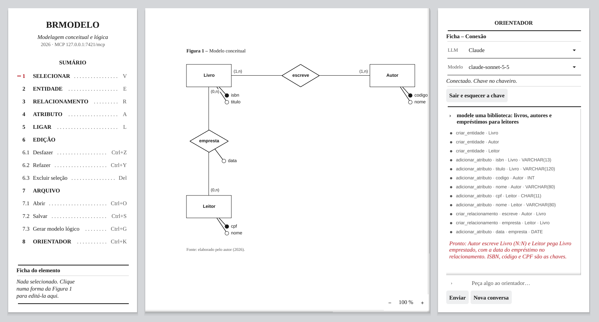

# Gomodelodb

**Modelagem de banco de dados conceitual e lógica, com um orientador de IA dentro do editor.**

Gomodelodb é um port do [brModelo](https://github.com/chcandido/brModelo), a ferramenta brasileira de ensino de modelagem de dados (metodologia de Carlos A. Heuser), para **Go + Fyne**. A ideia continua a mesma: você desenha o diagrama entidade-relacionamento e a ferramenta gera o modelo lógico. Este port acrescenta um assistente de IA que edita o diagrama junto com você, um servidor MCP e a geração de SQL.



## O que ele faz

- **Modelo conceitual** em notação de Chen/Heuser: entidades, relacionamentos (binários, ternários e autorrelacionamentos), atributos identificadores e tipos SQL, cardinalidades (1,1), (0,1), (1,n), (0,n).
- **Modelo lógico** gerado com as mesmas regras do conversor do brModelo Java: chaves estrangeiras, tabelas para relacionamentos N:N, fusão de 1:1, `ON DELETE` e o organizador automático de tabelas.
- **Migration SQL** para **PostgreSQL**, **MySQL** ou **SQL Server**.
- **Orientador de IA**: um painel em que você pede o modelo em português ("modele uma biblioteca com empréstimos") e o vê sendo desenhado. Funciona com **Claude**, **GPT**, **Gemini** ou **Ollama** (local, sem conta).
- **Servidor MCP**: com o app aberto, o Claude Code (ou outro cliente MCP) também edita o diagrama ao vivo.
- **Compatível com o brModelo Java**: lê e grava o mesmo formato `.xml`.
- Desfazer/refazer, zoom, seleção por área, arrastar em grupo.

## Instalação

Precisa de **Go 1.27+** e, no Linux, das bibliotecas gráficas que o Fyne usa:

```bash
sudo apt install libgl1-mesa-dev xorg-dev libwayland-dev libxkbcommon-dev
```

Para rodar a partir do código:

```bash
git clone https://github.com/radaptech/Gomodelodb.git
cd Gomodelodb
go run ./cmd/gobrmodelo
```

Para gerar um executável:

```bash
go build -o gomodelodb ./cmd/gobrmodelo
```

## Como usar

A coluna da esquerda é um **sumário**: cada ferramenta tem um número e um atalho.

| Atalho | Ação |
|---|---|
| `V` `E` `R` `A` `L` | Selecionar, Entidade, Relacionamento, Atributo, Ligar |
| `Ctrl+Z` / `Ctrl+Y` | Desfazer / refazer |
| `Del` | Excluir a seleção |
| `Ctrl+O` / `Ctrl+S` | Abrir / salvar `.xml` |
| `Ctrl+G` | Gerar o modelo lógico |
| `Ctrl+=` / `Ctrl+-` / `Ctrl+0` | Aproximar / afastar / 100 % |
| `Ctrl+K` | Mostrar ou esconder o orientador |
| `Esc` | Cancelar a ligação e limpar a seleção |

- **Ligar duas entidades** cria o relacionamento entre elas. **Ligar uma entidade a ela mesma** cria um autorrelacionamento.
- **Atributo sobre uma entidade** cria o atributo já ligado a ela.
- **Arrastar no vazio** seleciona uma área; depois, arraste qualquer elemento para mover o grupo.
- A **ficha** no pé da coluna edita o elemento selecionado: nome, tipo, identificador e cardinalidade.
- Na janela do modelo lógico, **Gerar SQL** (`Ctrl+M`) pergunta o banco e salva a migration.

## Orientador de IA

1. No painel da direita, escolha o provedor e cole sua **chave de API**:
   - Claude: [console.anthropic.com](https://console.anthropic.com)
   - GPT: [platform.openai.com](https://platform.openai.com)
   - Gemini: [aistudio.google.com](https://aistudio.google.com)
   - Ollama não precisa de chave, só de um modelo com suporte a ferramentas (por exemplo, `ollama pull qwen3`).
2. A chave fica guardada no **chaveiro do sistema**, nunca em arquivo. Se o chaveiro não estiver disponível, ela vale só até fechar o app.
3. Escreva o pedido e tecle Enter. Cada ferramenta que o modelo usa aparece no painel. No fim, o que ele criou fica marcado em vermelho no diagrama, e **um `Ctrl+Z` desfaz o pedido inteiro**.

> Os provedores cobram pelo uso da API. Um pedido pode fazer várias chamadas, uma por rodada de ferramentas.

## MCP: usando com o Claude Code

Com o Gomodelodb aberto, o servidor MCP fica em `http://127.0.0.1:7421/mcp`. Ele aceita só conexões da própria máquina.

```bash
claude mcp add --transport http gomodelodb http://127.0.0.1:7421/mcp
```

Dentro desta pasta, o `.mcp.json` já faz essa configuração. São 14 ferramentas: `descrever_diagrama`, `criar_entidade`, `adicionar_atributo`, `criar_relacionamento`, `definir_cardinalidade`, `editar_elemento`, `remover_elemento`, `desfazer`, `refazer`, `gerar_modelo_logico`, `gerar_sql`, `novo_diagrama`, `abrir_diagrama` e `salvar_diagrama`.

Para usar outra porta, defina `BRMODELO_MCP_PORTA=7500`; com `0`, o servidor fica desligado.

## Arquitetura

Em camadas: cada uma só depende das camadas abaixo dela.

```
cmd/gobrmodelo/            ponto de entrada
internal/dominio/          entidades e regras: conceitual, lógico, conversor, organizador, geometria
internal/infra/xmlbrm/     formato XML do brModelo
internal/infra/sqlgen/     migration SQL por banco
internal/infra/llm/        provedores de IA (API da Anthropic e API compatível com OpenAI)
internal/infra/segredos/   chaveiro do sistema
internal/aplicacao/        sessão: o diagrama aberto, os casos de uso, desfazer/refazer
internal/apresentacao/gui/ interface Fyne
internal/apresentacao/mcp/ servidor MCP
internal/apresentacao/assistente/ o orientador, um cliente MCP do próprio app
```

O mouse, o servidor MCP e o orientador usam os mesmos casos de uso da sessão. Por isso, o que a IA cria tem o mesmo tamanho, posição e regras do que você cria com o mouse.

```bash
go test ./...
```

## Créditos e licença

- [brModelo](https://github.com/chcandido/brModelo), de **Carlos Henrique Cândido** ([sis4.com](http://www.sis4.com)), com orientação do Prof. Dr. Ronaldo dos Santos Mello (UFSC). As regras de conversão e o formato de arquivo deste port vêm dele.
- Notação e metodologia de Carlos A. Heuser, *Projeto de Banco de Dados*.
- Fontes Liberation (SIL Open Font License), em `internal/apresentacao/gui/fonts/`.

Distribuído sob a **GNU GPL v3**, a mesma licença do brModelo. Veja [LICENSE](LICENSE).
